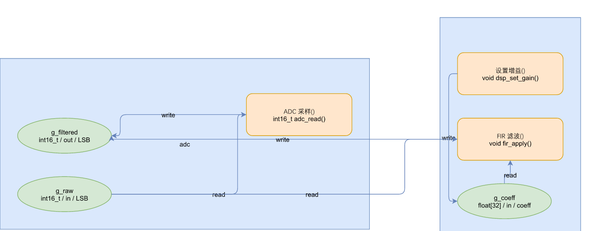
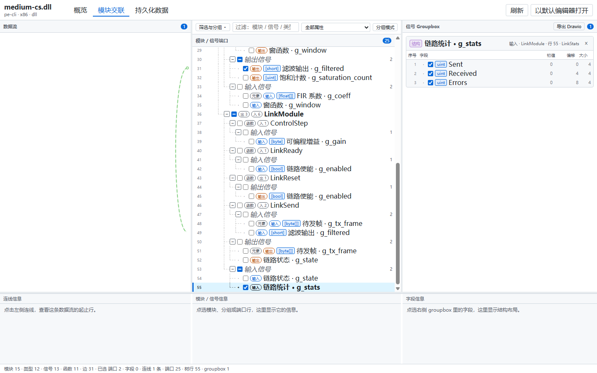
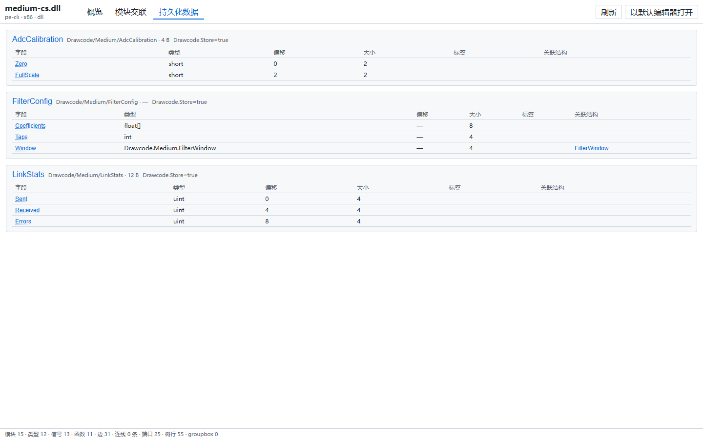
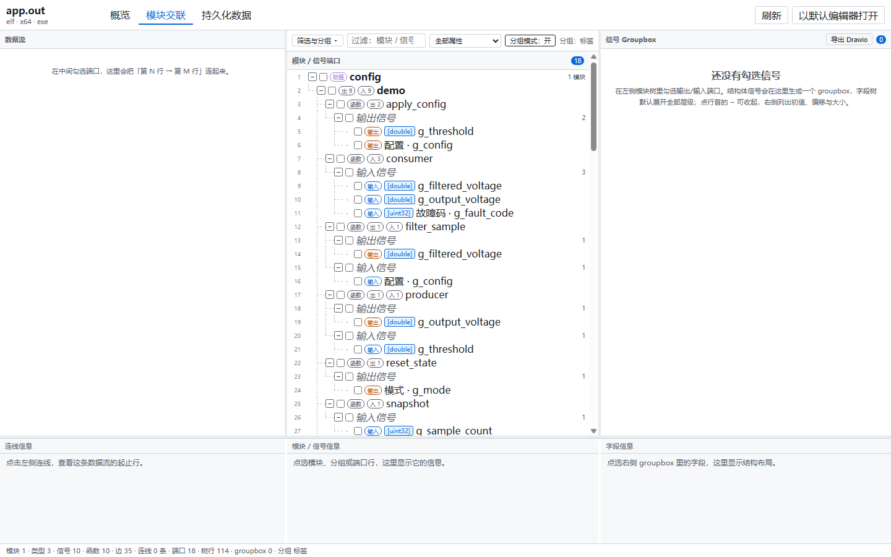

# drawcode

[English](README.md) | [中文](README.zh-CN.md) | **Español**

> Deja que el artefacto compilado explique el esqueleto del sistema: cómo se interconectan los módulos,
> cómo fluyen las señales, qué datos son persistentes. Explora los ensamblados en VS Code, o dibuja
> el código fuente anotado como diagramas editables de [draw.io](https://www.drawio.com/).

Funciona en Windows, Linux y macOS. La CLI no tiene dependencias de ejecución de terceros: Node 22.18+.
Solo hace falta un runtime .NET 10+ para leer artefactos PE/CLI `.dll` mediante el sidecar incluido;
el runtime no se incluye ni se recorta. Si falta, la extensión e `inspect` muestran instrucciones de
instalación en lugar de fallar en silencio, y el mismo VSIX funciona en Windows y Linux.



## Qué es

drawcode hace que **el propio código del ensamblado sea el modelo-resumen del gemelo digital del
sistema**: sin un proyecto de modelado aparte, solo una capa de declaraciones dentro del código.

| Capacidad | Qué hace | Punto de entrada |
| :--- | :--- | :--- |
| **Exploración de ensamblados** (la línea principal) | Abre un `.dll` / `.so` / `.out` / `.a` / `.o` y lee su resumen, las interconexiones entre módulos, los datos de señal y las definiciones de persistencia; varios artefactos pueden organizarse en un árbol de ensamblados con grupos y alias; los módulos/señales marcados se exportan a Drawio, Mermaid (.mmd) y Markdown (.md) | Extensión de VS Code |
| **Plantillas de metadatos** | Copia un fichero de cabecera o de atributos y pon la dirección de interconexión, la semántica de señal y las marcas de persistencia en la capa de declaración — eso es lo que hace legible un artefacto | [`docs/templates.md`](docs/templates.md) |
| **Fuente a diagrama** | Un fichero fuente o una carpeta entera → `.drawio`; clic derecho en el explorador para generar en el sitio, útil cuando solo quieres un grupo local de módulos | Menú contextual de la extensión / `build` |
| **JSON del artefacto** | Relee la estructura del artefacto como JSON canónico, para posprocesar o alimentar tus propias herramientas | `inspect` |

Una implementación completa siempre va por delante de su documento de diseño, y el pensamiento se
registra siempre después del código. Lo que falta entre esos tres nunca es otro documento: es un
resumen que **se compila y evoluciona junto con el código**, lo bastante preciso para compilar y lo
bastante estructurado para leer arquitectura de él.

drawcode devuelve ese resumen al propio código. Una capa de declaración basta para que un ensamblado
sea a la vez una implementación ejecutable y una visión general del sistema — y como *es* el código,
no puede desviarse.

## Explorar artefactos compilados

`drawcode inspect` también alimenta un visor de solo lectura en VS Code. Abre un `.dll`, `.so`,
`.out`, `.a` o `.o` y el editor personalizado muestra lo que se compiló dentro:

- **Resumen** — formato, arquitectura, recuento de entidades y diagnósticos del lector.
- **Interconexión de módulos** — un árbol virtualizado de módulos, tipos, señales y funciones; al
  marcar una señal se dibuja su flujo en la canaleta izquierda, desde la fila que escribe hasta la
  que lee.
- **Datos persistentes** — los tipos marcados con `Store` como tablas ER, con tipos de campo y
  enlaces a tipos anidados.
- **Árbol de ensamblados** — organiza varios artefactos en un árbol, con grupos, alias y alta
  masiva «añadir desde el espacio de trabajo».



*Interconexión de módulos: marca un puerto y el cable va de su fila de escritura a su fila de
lectura; los campos de una señal de tipo struct se despliegan en el grupo de la derecha.*

| Datos persistentes (tipos `Store` como tablas ER) | Artefacto C, agrupado por etiqueta |
| :---: | :---: |
|  |  |

La extensión incorpora el mismo núcleo de análisis que la CLI (`readArtifact`) en lugar de lanzar un
proceso externo, y nunca carga ni ejecuta el artefacto. Requisitos y ajustes en
[`docs/vscode-extension.md`](docs/vscode-extension.md).

## Plantillas de metadatos: hacer legible un artefacto

Cuánto se puede leer de un artefacto depende de cuánto pongas en la capa de declaración. Dos
plantillas aportan cada una el añadido mínimo:

- **C#**: copia [`templates/csharp/DrawcodeAttributes.cs`](templates/csharp/DrawcodeAttributes.cs) y
  anota campos, propiedades, métodos o tipos.
- **C**: copia [`templates/c/DrawcodeMeta.h`](templates/c/DrawcodeMeta.h) y el `.c` correspondiente,
  y escribe la capa de declaración con macros; los registros de tamaño fijo van a una sección propia.

Ambas plantillas comparten la misma semántica y describen **solo la capa de declaración** (quién lee
y escribe qué, qué tipo es dato persistente, qué módulo es raíz de la descomposición). Ninguna
registra comportamiento en tiempo de ejecución — así que `-O0` y `-O2` producen los mismos datos.

`size` y `offset` los calcula el compilador (con `sizeof` / `offsetof` en el lado C). La diferencia
entre ambas es el grado de tipado: C# usa clases de atributo, así que un nombre de propiedad mal
escrito o un tipo incorrecto **falla en tiempo de compilación**; C usa etiquetas de texto, así que
una clave mal escrita se ignora en silencio como etiqueta desconocida.

Las tablas de parámetros y las restricciones de compilación (`--gc-sections`, `PublishTrimmed`)
están en [`docs/templates.md`](docs/templates.md).

## Fuente a diagrama

No hace falta compilar primero. **Haz clic derecho** en un fichero fuente o en una carpeta del
explorador y elige «Generar diagrama Drawio» para producir un `.drawio` en el sitio (un fichero
`Foo.cs` → `Foo.cs.drawio`; una carpeta `demo/` → `demo/demo.drawio`, fusionando recursivamente
todas las fuentes soportadas que contenga). Sirve para ver las interconexiones entre **unos pocos
módulos**, no el proyecto entero.

Extensiones de fuente soportadas: `.c .h .cpp .hpp .cc .hh` en el lado C, `.cs` en el lado C#.

## Por qué el código fuente es la única fuente de verdad

Los puntos siguientes exponen la postura de la línea *fuente → diagrama*. La línea de exploración
de ensamblados se apoya en el mismo principio: el código es la única fuente de verdad.

La mayoría de las herramientas de «código a diagrama» generan una imagen y se detienen ahí. La imagen queda obsoleta 
en el momento en que alguien edita el código, porque **el diagrama se convierte en silencio en una segunda fuente de 
verdad** — y dos fuentes de verdad siempre divergen. El arreglo habitual es peor: exportar un JSON intermedio y luego 
inventar hashes, detección de deriva y fusiones a tres bandas para reconciliarlos.

`drawcode` adopta la postura contraria.

- **El código fuente es la única fuente de verdad.** La semántica vive en el código, expresada con macros, atributos 
  y comentarios estructurados. Nunca se escribe un JSON intermedio en disco — el IR existe solo en memoria y se 
  reconstruye desde el código en cada ejecución.
- **El diagrama solo transporta lo que el código no puede expresar**: el diseño, que es una decisión humana. Arrastra 
  un nodo en draw.io y la nueva posición vuelve al IR en la siguiente ejecución.
- **La dirección inversa es deliberadamente estrecha.** Solo se reescribe la *capa de declaración* — sentencias de 
  macro `SIGNAL_*` y atributos de anotación. **La lógica del cuerpo de las funciones nunca se reescribe**, por diseño.
- **Idempotente.** Compilar → editar → sincronizar → compilar no produce ningún cambio en el código. Esto lo afirman 
  las pruebas, no se supone.
- **Los dorados fijan el contrato.** El IR y la geometría se comparan exactamente contra casos dorados
  versionados, así que un cambio en el analizador o en el enrutado aparece como un diff revisable en lugar de
  una deriva silenciosa.

## Inicio rápido

Elige el camino según lo que ya tengas. Los cuatro son independientes.

| Qué tienes | Qué quieres | Camino |
| :--- | :--- | :--- |
| **Una idea / una descripción de diseño** | que un agente genere un ensamblado gemelo digital legible | **Camino A** |
| Un **artefacto** compilado | explorar módulos, señales y datos persistentes | Camino B |
| **Código fuente** C / C# | el diagrama de interconexión | Camino C |
| Un **artefacto** compilado | JSON estructurado en vez de una imagen | Camino D |

La referencia completa de la línea de comandos es común a los cuatro caminos — ver
[Uso desde la línea de comandos](#uso-desde-la-línea-de-comandos).

### Camino A: crear un ensamblado gemelo con un agente

El uso más típico: solo tienes una idea o una descripción de diseño, y pides a un agente que
escriba código anotado que compile en un ensamblado cuya estructura se pueda releer.

```text
Lee templates/csharp/DrawcodeAttributes.cs y docs/annotations.md.

Abajo está el sistema que quiero modelar. Genera un código C# que, una vez compilado,
permita a drawcode leer la interconexión de módulos, las lecturas/escrituras de señales
y los datos persistentes:

<pega aquí tu descripción de diseño>

Requisitos:
- Un public static class por módulo, marcado [Drawcode(Root = "nombre del módulo")] como raíz
- Los datos que pasan entre módulos se declaran como campos static y se anotan con
  [Drawcode(Direction.X, Unit, Alias)]
- Direction es relativo al módulo: In = se produce aquí, Out = se consume aquí.
  Confirma cada dirección antes de escribirla.
- Estructuras persistentes: record o class marcado [Drawcode(Store = true)]
- Expresa la interacción entre módulos con sentencias reales de lectura/escritura en el cuerpo
  de los métodos, nunca con comentarios — las aristas salen de analizar los cuerpos

Después: dotnet build para confirmar que compila; ejecuta drawcode inspect e informa
el número de módulos, señales, funciones y aristas; explica cualquier señal que falte.
```

Luego cierra el ciclo:

```bash
dotnet build
node typescript/bin/drawcode.ts inspect bin/Release/net9.0/YourProject.dll --out model.json
```

**No te saltes este paso.** Si la salida del agente solo *parece* un gemelo o si *lo es* solo se
sabe releyéndola.

Juego completo de prompts (generar desde una idea, anotar código existente, añadir macros de C,
pedir a un agente que explique un artefacto, trampas habituales):
[`docs/agent-prompts.md`](docs/agent-prompts.md) *(中文)*.

### Camino B: explorar un artefacto en VS Code

La extensión se instala actualmente **desde un VSIX construido en el repositorio**; todavía no está
publicada en el marketplace.

```bash
cd editors/vscode
npm install
npm run package     # genera out/drawcode-artifact-viewer-0.4.0.vsix
```

Luego ejecuta «Extensiones: Instalar desde VSIX…» en VS Code y elige ese fichero. Haz doble clic en
cualquier `.dll` / `.so` / `.out` / `.a` / `.o`, o ejecuta el comando `Drawcode: 打开程序集`.

Para modificarla: `npm install && npm run build` y luego pulsa `F5` para lanzar el Extension
Development Host.

Requisitos: VS Code >= 1.90; los `.dll` necesitan el runtime .NET 10+ (el sidecar viaja dentro del
VSIX, el runtime no), los ELF y los `ar` no. Si falta el runtime, la extensión muestra instrucciones
de instalación en lugar de una vista vacía. Detalles en [`docs/vscode-extension.md`](docs/vscode-extension.md) *(中文)*.

### Camino C: fuente → drawio

**Lo más rápido: clic derecho en la extensión.** Con la extensión del Camino B instalada, haz clic
derecho en un fichero o carpeta del explorador y elige «Generar diagrama Drawio»; el `.drawio`
aparece en el sitio.

**O usa la CLI** (Node 22.18+, sin dependencias de ejecución de terceros):

```bash
git clone <this-repo> && cd drawcode

# Analiza los cuatro ficheros de examples/small/c y emite el diagrama más una vista previa
node typescript/bin/drawcode.ts build \
    examples/small/c/adc.h examples/small/c/adc.c \
    examples/small/c/dsp.h examples/small/c/dsp.c \
    --root examples/small/c \
    --out out/flow.drawio --svg out/flow.svg
```

Abre `out/flow.drawio` en draw.io para editarlo.

**Ida y vuelta del diseño** (opcional): reordena en draw.io, guarda y reutiliza esa disposición con
`--layout-from`, o escribe las anotaciones de vuelta en el código fuente:

```bash
node typescript/bin/drawcode.ts build ... --layout-from out/flow.drawio --out out/flow.drawio
node typescript/bin/drawcode.ts sync out/flow.drawio examples/small/c/*.h examples/small/c/*.c \
    --root examples/small/c                    # simulación: informa qué cambiaría
node typescript/bin/drawcode.ts sync out/flow.drawio examples/small/c/*.h examples/small/c/*.c \
    --root examples/small/c --write            # escribe de verdad
```

### Camino D: leer los datos estructurados del artefacto

Para obtener JSON en vez de una imagen, usa `inspect` (el artefacto nunca se carga ni se ejecuta):

```bash
node typescript/bin/drawcode.ts inspect path/to/Your.dll --out model.json
```

Referencia de campos: [`docs/artifact-format.md`](docs/artifact-format.md).

Los comandos de compilación, el mapa del repositorio y los comandos de prueba están en
[`docs/implementations.md`](docs/implementations.md).

## Uso desde la línea de comandos

No es un quinto camino, sino la referencia común de los cuatro anteriores: el Camino A usa `inspect`
para verificar, el Camino C usa `build`/`sync`, el Camino D usa `inspect` directamente. El Camino B
es la extensión y no pasa por la línea de comandos.

```
drawcode build <files...> [--root DIR] [--out FILE] [--merge] [--layout-from FILE] [--svg FILE]
                [--inline] [--cards] [--no-rw-labels] [--straight-edges]
drawcode sync  <drawio> <files...> [--root DIR] [--write]
drawcode inspect <artifact> [--out FILE] [--infer-edges]
```

| Comando | Qué hace | Lo usan |
| :--- | :--- | :--- |
| `build` | Analiza las fuentes → construye el IR → escribe el `.drawio`. `--layout-from` reutiliza el diseño hecho a mano de un diagrama existente. `--svg` emite además una vista previa de solo lectura que comparte las mismas coordenadas. | Camino C |
| `sync` | Lee el `.drawio` → aplica diseño y atributos de anotación → reescribe la **capa de declaración** en el código fuente. Es una simulación salvo que se pase `--write`. | Camino C |
| `inspect` | Lee un artefacto compilado (`.dll` / `.so` / `.out` / `.a` / `.o`) y emite JSON canónico. Nunca carga ni ejecuta el artefacto. Los PE `.dll` los lee el sidecar .NET incluido; los ELF y archivos `ar` se leen en proceso. | Caminos A y D |

`--inline` pliega las señales de una escritura y una lectura en aristas directas entre dispositivos,
`--cards` dibuja las funciones con `asset` como tarjetas de imagen, `--no-rw-labels` elimina las
etiquetas `read`/`write` de las aristas y `--straight-edges` sustituye el enrutado ortogonal por
líneas rectas. Sin ellos, la salida es idéntica byte a byte al comportamiento por defecto.

## Conceptos clave

1. **Una fuente persistente, un artefacto derivado.** El código es el hecho; el `.drawio` es una vista más el diseño 
   que solo un humano puede aportar. Detalles: [`docs/architecture.md`](docs/architecture.md).
2. **Las anotaciones son lo único que un analizador no puede inferir.** La dirección y los metadatos se escriben 
   *dentro del código*: un comentario `/// @drawcode` en C, un atributo `[Drawcode(Direction.In)]` en C#. 
   Referencia a nivel de campo: [`docs/annotations.md`](docs/annotations.md).
3. **Las aristas se derivan, no se analizan.** Las aristas `read`/`write` provienen de examinar el *cuerpo* de las 
   funciones para ver qué globales tocan. Editar un comentario cambia una etiqueta; nunca mueve una línea. Esto 
   sorprende a menudo, y es deliberado.
4. **Las coordenadas son relativas al padre.** En `.drawio`, `mxGeometry` y `mxPoint` son relativos a su contenedor. 
   `read_layout` convierte a coordenadas absolutas del lienzo y `to_drawio` convierte de vuelta — el único punto de 
   conversión que evita que la deriva se acumule entre idas y vueltas.
5. **draw.io comprime por defecto.** Al guardar, almacena el contenido de `<diagram>` como 
   `base64(raw-deflate(url-quote(xml)))`. Leer solo XML plano significa **devolver un diseño vacío en silencio** y 
   descartar la disposición hecha a mano por el usuario. Aquí se leen ambas formas, y una carga ilegible lanza una 
   excepción en lugar de devolver vacío. Detalles del formato: [`docs/drawio-format.md`](docs/drawio-format.md).

## Compromisos frente a SysML v2

drawcode no hace lo que hace SysML v2. La tabla siguiente es un compromiso, no una comparación de
capacidades — los dos resuelven problemas en capas distintas.

| Dimensión | drawcode | SysML v2 |
| :--- | :--- | :--- |
| Público y curva de aprendizaje | Equipos que ya dominan C / C#; una docena de claves de anotación, sin lenguaje nuevo | Equipos de ingeniería de sistemas multidisciplinar; exige el stack semántico SysML v2 / KerML |
| Código existente | Se lee directamente de los artefactos ya construidos, sin refactorizar | Hay que reconstruir los modelos |
| Impacto en la compilación existente | Copiar un fichero de plantilla, intrusión cero | Requiere una herramienta de modelado y un proceso de compilación a su alrededor |
| Leer la estructura de un binario ya existente | **Sí** (`.dll` / `.so` / `.out` / `.a` / `.o`) | No |
| Fuente de verdad y deriva | La fuente o el artefacto es la única fuente de verdad; no hay nada más que mantener | El modelo es el artefacto principal; modelo y código se mantienen ambos a mano |
| Comprobación en compilación | `size` / `offset` los calcula el compilador (`sizeof` / `offsetof` en el lado C); C# usa atributos fuertemente tipados, así que una propiedad mal escrita o un tipo incorrecto falla en compilación; C usa etiquetas de texto, donde una clave mal escrita se ignora en silencio | Validación semántica a nivel de modelo, pero no dice si el modelo coincide con la implementación |
| Comportamiento y tiempo | Flujo de interacción (interconexión de módulos, caminos de lectura/escritura de señal); las máquinas de estado y los diagramas de secuencia **no están soportados** | Sí (máquinas de estado, interacciones, tiempo) |
| Diagramas y exportación | Emite `.drawio` estándar; la exportación a PNG / SVG y el «reabrir un PNG en draw.io» los cubren las herramientas oficiales de draw.io, y aquí no se reimplementan a propósito | El diseño y la exportación los gestiona la herramienta de modelado |
| Control de versiones | Fuente y `.drawio` son ambos texto, `git diff` normal funciona | La notación textual también es apta para git, pero necesita un repositorio de modelo aparte |
| Estandarización y ecosistema | MIT, código abierto en este repositorio; convención propia, sin interoperabilidad con herramientas de terceros | Estándar de OMG (v2.0 adoptada en 2025-09, Document Status: formal) con Boeing, Airbus, Lockheed Martin, Siemens, Dassault Systèmes, Ansys, MathWorks, IBM, PTC y Sparx Systems entre los colaboradores |
| Asistencia de agentes | Las anotaciones *son* la estructura, la salida es texto determinista (dorados comparados byte a byte) y `SKILL.md` está escrito para el siguiente **adaptador de lenguaje** | La notación textual también puede ser leída y escrita por agentes, pero solo tras entender todo el stack semántico |

**Por qué elegirlo**

La intención vive en los documentos de diseño, el diseño aterriza en una implementación completa, y
siempre hay una brecha entre los tres: el documento no sigue el ritmo del código, y el código no se
puede releer como diseño. El remedio habitual es otro documento de modelado — que empieza a
envejecer en el momento en que se escribe.

drawcode sostiene que **el propio ensamblado debe cargar con ese resumen**. Una capa de declaración
entra en el código fuente, viaja con la compilación hasta el artefacto, y ese mismo ensamblado es a
la vez una implementación ejecutable y un **resumen estructurado del gemelo digital del sistema**:
cómo se interconectan los módulos, cómo fluyen las señales, qué datos son persistentes, qué módulos
son raíces de la descomposición. Lo bastante preciso para compilar y lo bastante estructurado para
leer arquitectura de él.

Esa es su posición: el puente entre la intención, el diseño y la implementación completa. Y como el
puente se apoya en el propio código, no puede desviarse por su cuenta.

**Cuál elegir**

- Quieres que el código del ensamblado sea a la vez el **resumen estructurado del gemelo digital del
  sistema**, para que la implementación declare su propia estructura y conecte intención, diseño e
  implementación → drawcode.
- La organización necesita trazabilidad de requisitos, casos de verificación, análisis paramétrico
  o colaboración multidisciplinar, y el modelo debe existir con independencia del código → SysML v2.

No son mutuamente excluyentes: drawcode puede servir como vista de solo lectura de un modelo SysML
en el lado de la implementación. El modelo dice lo que *debería* haber; el artefacto dice lo que
*hay*, y la diferencia es la lista que hay que reconciliar.

## Documentación

| Para saber sobre | Lee |
| :--- | :--- |
| **Qué promete el producto, y qué actualizar cuando cambias un comportamiento** | **[Requisitos y criterios de aceptación](docs/requirements.md)** *(sin traducción al español todavía)* — el contrato autorizado de requisitos: cada capacidad, sus criterios de aceptación y el protocolo de cambio que siguen todos los demás documentos |
| **Cómo se juzga que un cambio es suficientemente bueno, y qué puerta debe pasar** | **[Restricciones de prueba y calidad](docs/test-and-quality.md)** *(sin traducción al español todavía)* — objetivos de calidad, qué puede y qué no puede ver cada nivel de prueba, qué evidencia se acepta, criterios de entrada y salida, mediciones registradas y graduación de defectos |
| Por qué el diseño tiene esta forma | [`docs/architecture.md`](docs/architecture.md) |
| Cada clave de anotación, con tipos y valores por defecto | [`docs/annotations.md`](docs/annotations.md) |
| Mapeo de `.drawio`, reglas de enrutado, semántica de coordenadas | [`docs/drawio-format.md`](docs/drawio-format.md) |
| Qué fijan los casos dorados y por qué están congelados | [`docs/conformance.md`](docs/conformance.md) |
| Cifras de prueba y verificación, características de rendimiento | [`docs/verification.md`](docs/verification.md) |
| El JSON `ArtifactModel` que emite `inspect` | [`docs/artifact-format.md`](docs/artifact-format.md) |
| Explorar un artefacto compilado en VS Code | [`docs/vscode-extension.md`](docs/vscode-extension.md)（中文） |
| Hacer legible tu propia compilación de C/C# | [`docs/templates.md`](docs/templates.md)（中文） |
| Pedir a un agente un ensamblado gemelo a partir de una idea | [`docs/agent-prompts.md`](docs/agent-prompts.md)（中文） |
| Ejecutar los proyectos de ejemplo incluidos | [`docs/examples.md`](docs/examples.md) |
| Compilar, probar, añadir un lenguaje | [`docs/contributing.md`](docs/contributing.md) |
| Escribir el adaptador para el siguiente lenguaje | [`typescript/SKILL.md`](typescript/SKILL.md) |

## Mantenimiento de este repositorio

[`docs/requirements.md`](docs/requirements.md) es la única fuente autorizada de lo que el producto
promete y de cómo se juzga cada promesa. Todo otro documento explica cómo se cumple una promesa;
cuando uno de ellos lo contradice, ese es el equivocado.

Un cambio de comportamiento no está terminado hasta que se hace su seguimiento. La tabla siguiente
es el contrato:

| Si cambias | También debes actualizar | Porque |
| :--- | :--- | :--- |
| Cualquier comportamiento visible para el usuario | El REQ y el AC correspondientes en [Requisitos](docs/requirements.md) | El requisito *es* la promesa; un comportamiento que se publica sin uno está indocumentado y por tanto no acordado |
| La ingestión de código, la semántica de anotaciones o la derivación de aristas | [Arquitectura](docs/architecture.md), [Anotaciones](docs/annotations.md), [Formato `.drawio`](docs/drawio-format.md) y las salidas esperadas del modelo | El analizador, el vocabulario y la geometría forman un solo contrato; actualizar uno sin los otros deja la suite verde y la documentación falsa |
| La disposición por defecto, el enrutado o cualquier geometría emitida | [Formato `.drawio`](docs/drawio-format.md) y las salidas de geometría esperadas | Las disposiciones hechas a mano están fijadas a esa geometría, así que un cambio silencioso rompe todos los diagramas ya en uso |
| Una clave de anotación o su semántica | [Anotaciones](docs/annotations.md) y [Plantillas](docs/templates.md) | Una clave se define una vez y se consume dos veces; una divergencia es pérdida silenciosa de datos |
| Una decisión de lectura de artefactos o un campo emitido | [Formato de artefactos](docs/artifact-format.md) y las expectativas de prueba de artefactos | Ese JSON lo consumen el editor y las herramientas de los usuarios; es un contrato público |
| Cualquier prueba, paso de la puerta o cifra medida | [Pruebas y calidad](docs/test-and-quality.md) **y** [Verificación](docs/verification.md) | La puerta es un contrato y las cifras un registro. Ambos se declaran en dos lugares, así que ambos tienen que moverse, o uno se convierte en una afirmación obsoleta en la que el siguiente lector confía |
| Cualquier documento | Su contraparte en los otros idiomas, en el mismo cambio | Un comportamiento documentado en un solo idioma es un fallo, no un retraso de traducción |

Las tablas de temas de este archivo y de [`docs/index.md`](docs/index.md) cuentan también como
documentos: un tema añadido a una y no a la otra es una página que nadie encuentra.

## Desarrollo

```bash
cd typescript && node --test                        # CLI, analizadores, IR, diseño, conformidad
cd editors/vscode && node --test test/*.test.mjs    # pruebas de la extensión
```

El sidecar PE de `tools/drawcode-metadata/` es .NET 10 puro y solo se compila/ejecuta cuando `inspect` lee un
`.dll`; el resto de la cadena de herramientas solo necesita Node 22.18+.

Las cifras actuales de prueba y verificación (número de tests, idempotencia, esquema, reproducción de
los dorados, características de rendimiento) están en [`docs/verification.md`](docs/verification.md).

## Limitaciones conocidas (enumeradas con honestidad)

- **El diseño es O(n²)**, así que los proyectos grandes son lentos. Todavía no se usa ningún índice espacial.
- **El renderizador offline no puede dibujar los saltos de línea `jumpStyle=arc`.** `jumpStyle` es una extensión de 
  draw.io ausente del núcleo open source de mxGraph. Los ficheros generados lo configuran correctamente y el cliente 
  de draw.io lo respeta, pero `tools/render/` no mostrará los saltos. Verifica los saltos en draw.io.
- **Los títulos de los contenedores swimlane se renderizan centrados** en el renderizador offline, aunque en draw.io 
  aparecen arriba a la izquierda. Es una limitación del renderizador, no un fallo del generador.
- **La medición de texto CJK en el renderizador offline es estimada.** jsdom no tiene motor de maquetación e informa 
  `offsetWidth = 0`, así que los anchos de glifo se aproximan. El texto en sí se renderiza correctamente (el 
  posicionamiento SVG no depende de esa medición); la *evitación* de etiquetas puede desviarse.
- **La vista previa SVG no comparte el enrutado de aristas del `.drawio`.** Las posiciones de los nodos sí se 
  comparten (ambas llaman al mismo diseño por defecto), pero `svg.ts` dibuja las aristas de centro a centro mientras 
  que `to_drawio` ejecuta la selección completa de anclas y la evitación de obstáculos. Por eso las aristas del SVG 
  cruzan formas de nodo que las rutas del `.drawio` rodean. Trata el SVG como una lectura estructural, no como una 
  vista previa fiel. Arreglarlo exige refactorizar `to_drawio` para exponer la geometría de las aristas como una 
  función compartida.
- **Los cuerpos de las funciones nunca se reescriben.** Restricción de diseño deliberada, no una carencia.
- **Los diagramas únicos con varios lenguajes no se resuelven por símbolo.** Los modelos de C y C# pueden fusionarse, 
  pero una referencia entre lenguajes al mismo nombre no se resuelve.
- **La multipágina / multívista, las capas y el filtrado por etiquetas no están conectados a la CLI.**
- **Las máquinas de estado y los diagramas de secuencia no están soportados.** La interconexión de
  módulos y los caminos de lectura/escritura de señal son el único flujo de interacción modelado hoy.
- **La geometría está congelada en los dorados.** Un algoritmo de diseño más rápido es bienvenido solo si cambia
  *lo rápido* que se calcula la geometría, nunca *qué* geometría se produce — de lo contrario todos los casos
  dorados divergen y los diseños hechos a mano dejan de coincidir.

## Licencia

[MIT](LICENSE). El material de terceros incluido está listado en [`tools/xsd/NOTICE.md`](tools/xsd/NOTICE.md).
