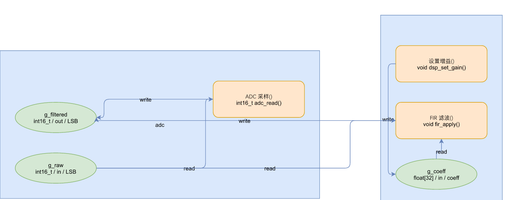
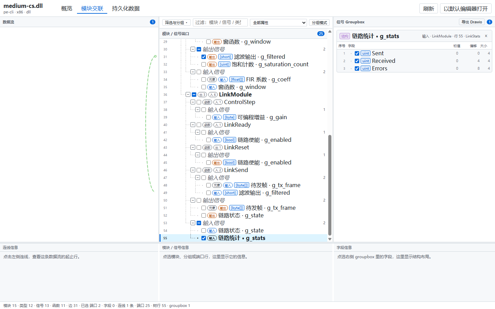
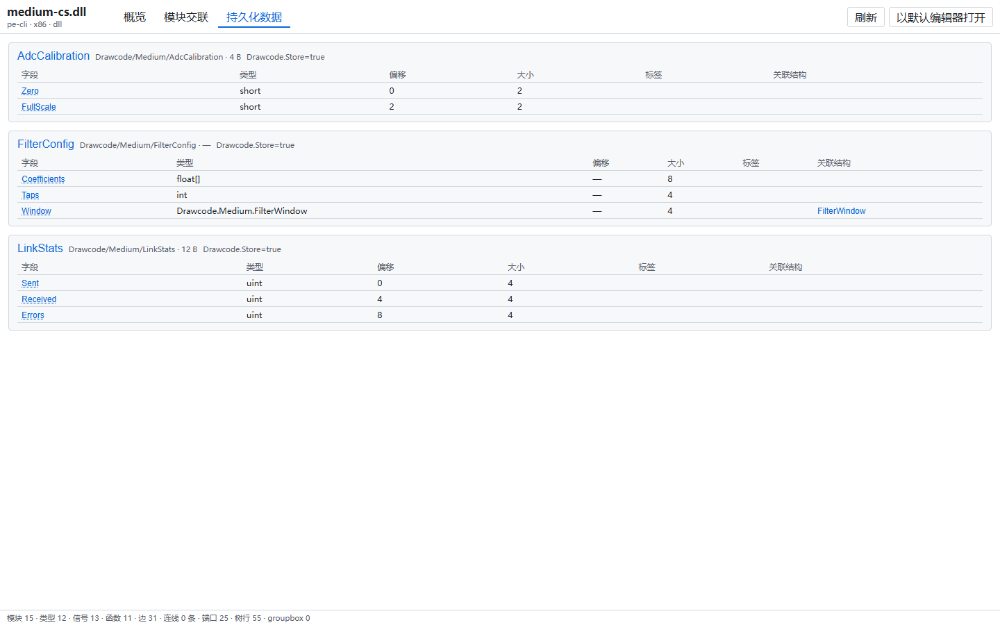
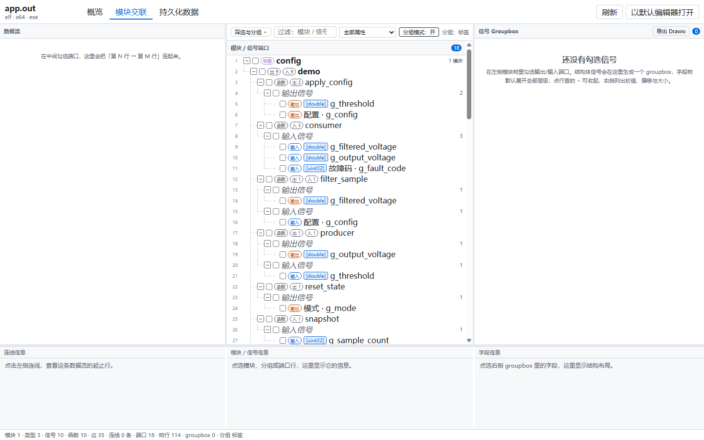

# drawcode

**English** | [中文](README.zh-CN.md) | [Español](README.es.md)

> Let a compiled artifact explain the system skeleton: how modules cross-link, how signals flow,
> which data is persistent. Browse assemblies in VS Code, or draw annotated sources as editable
> [draw.io](https://www.drawio.com/) diagrams.

Runs on Windows, Linux and macOS. The CLI has no third-party runtime dependencies: Node 22.6+.
A .NET 10 runtime is needed only to read PE/CLI `.dll` artifacts through the bundled sidecar.



## What it is

drawcode lets **the assembly code itself be the digital-twin summary model of the system**: no
separate modelling project — just one layer of declarations inside the code.

| Capability | What it does | Entry point |
| :--- | :--- | :--- |
| **Assembly browsing** (the main line) | Open a `.dll` / `.so` / `.out` / `.a` / `.o` and read its overview, module cross-links, signal data and persistence definitions; several artifacts can be organised into an assembly tree with groups and aliases | VS Code extension |
| **Metadata templates** | Copy one header or attribute file, put cross-link direction, signal semantics and persistence markers into the declaration layer — that is what makes an artifact readable at all | [`docs/templates.md`](docs/templates.md) |
| **Source to diagram** | A source file or a whole directory → `.drawio`; right-click in the explorer to generate in place, useful when you only want one local group of modules | Extension context menu / `build` |
| **Artifact JSON** | Read structure back out of an artifact as canonical JSON, to post-process or feed your own tools | `inspect` |

A complete implementation always runs ahead of its design document, and the thinking is always
recorded later than the code. What is missing between those three is never another document — it is
a summary that **compiles and evolves together with the code**: precise enough to build, structured
enough to read architecture out of.

drawcode puts that summary back into the code itself. One declaration layer is enough for an
assembly to be both a runnable implementation and a system overview — and because it *is* the code,
it cannot drift.

## Browsing compiled artifacts

`drawcode inspect` also powers a read-only VS Code viewer. Open a `.dll`, `.so`, `.out`, `.a` or
`.o` and the custom editor shows what was compiled into it:

- **Overview** — format, architecture, entity counts and reader diagnostics.
- **Module cross-links** — a virtualized tree of modules, types, signals and functions; checking a
  signal draws its flow in the left-hand wire gutter, from the writing row to the reading row.
- **Persistent data** — types marked `Store` as ER tables, with field types and nested-type links.
- **Assembly tree** — organise several artifacts into a tree, with groups, aliases and a bulk
  "add from workspace".



*Module cross-links: check a port and the wire runs from its writing row to its reading row; a
struct signal's fields expand in the right-hand groupbox.*

| Persistent data (`Store` types as ER tables) | C artifact, grouped by tag |
| :---: | :---: |
|  |  |

The extension bundles the same parsing core as the CLI (`readArtifact`) rather than starting an
external process, and it never loads or executes the artifact. Prerequisites and settings live in
[`docs/vscode-extension.md`](docs/vscode-extension.md).

## Metadata templates: making an artifact readable

How much can be read out of an artifact depends on how much you put into the declaration layer.
Two templates each supply the minimal addition:

- **C#** copy [`templates/csharp/DrawcodeAttributes.cs`](templates/csharp/DrawcodeAttributes.cs) and
  annotate fields, properties, methods or types.
- **C** copy [`templates/c/DrawcodeMeta.h`](templates/c/DrawcodeMeta.h) and the matching `.c`, and
  write the declaration layer with macros; fixed-size records go into a custom section.

Both templates share the same semantics and describe **only the declaration layer** (who reads and
writes what, which type is persistent data, which module is a decomposition root). Neither records
runtime behaviour — so `-O0` and `-O2` produce the same data.

`size` and `offset` are computed by the compiler (via `sizeof` / `offsetof` on the C side). The
difference between them is how strongly typed they are: C# uses attribute classes, so a misspelt
property name or a wrong type **fails at compile time**; C uses string tags, so a misspelt key is
silently ignored as an unknown tag.

Parameter tables and build constraints (`--gc-sections`, `PublishTrimmed`) are in
[`docs/templates.md`](docs/templates.md).

## Source to diagram

You do not have to compile first. **Right-click** a single source file or a whole folder in the
explorer and pick "Generate Drawio diagram" to produce a `.drawio` in place (one file `Foo.cs` →
`Foo.cs.drawio`; a folder `demo/` → `demo/demo.drawio`, recursively merging every supported source
inside it). This is for seeing the cross-links between **a few modules**, not the whole project.

Supported source extensions: `.c .h .cpp .hpp .cc .hh` on the C side, `.cs` on the C# side.

## Why source code is the only source of truth

The points below state the position for the *source → diagram* line. The assembly-browsing line
rests on the same principle: code is the single source of truth.

Most "code to diagram" tools generate a picture and stop there. The picture goes stale the moment
someone edits the code, because **the diagram quietly becomes a second source of truth** — and two
sources of truth always drift. The usual fix is worse: export an intermediate JSON, then invent
hashes, drift detection and three-way merges to reconcile them.

`drawcode` takes the opposite position.

- **Source code is the only source of truth.** Semantics live in the code, expressed with macros,
  attributes and structured comments. No intermediate JSON is ever written to disk — the IR exists
  only in memory and is rebuilt from code on every run.
- **The diagram carries only what code cannot express**: layout, which is a human decision. Drag a
  node in draw.io, and the new position round-trips back into the IR on the next run.
- **The reverse direction is deliberately narrow.** Only the *declaration layer* is written back —
  `SIGNAL_*` macro statements and annotation attributes. **Function body logic is never rewritten**,
  by design.
- **Idempotent.** Build → edit → sync → build produces zero code changes. This is asserted by tests,
  not assumed.
- **Goldens pin the contract.** The IR and geometry are compared exactly against committed golden
  cases, so a parser or router change shows up as a reviewable diff rather than silent drift.

## Quick start

Pick the path that matches what you already have. The three are independent.

| What you have | What you want | Path |
| :--- | :--- | :--- |
| C / C# **source** | the cross-link diagram | Path A |
| A compiled **artifact** | browse modules, signals, persistent data | Path B |
| A compiled **artifact** | structured JSON instead of a picture | Path C |
| A project with no annotations yet | make its artifact readable | do [metadata templates](docs/templates.md) first, then Path B |

### Path A: source → drawio

**Fastest — right-click in the extension.** Once the Path B extension is installed, right-click a
source file or folder in the explorer and pick "Generate Drawio diagram"; the `.drawio` appears
in place.

**Or use the CLI** (Node 22.6+, no third-party runtime dependencies):

```bash
git clone <this-repo> && cd drawcode

# Parse the four files under examples/small/c, emit the diagram plus a preview
node typescript/bin/drawcode.ts build \
    examples/small/c/adc.h examples/small/c/adc.c \
    examples/small/c/dsp.h examples/small/c/dsp.c \
    --root examples/small/c \
    --out out/flow.drawio --svg out/flow.svg
```

Open `out/flow.drawio` in draw.io to edit it.

**Layout round-trip** (optional): rearrange in draw.io, save, then reuse that arrangement with
`--layout-from`, or write annotations back into the source:

```bash
node typescript/bin/drawcode.ts build ... --layout-from out/flow.drawio --out out/flow.drawio
node typescript/bin/drawcode.ts sync out/flow.drawio examples/small/c/*.h examples/small/c/*.c \
    --root examples/small/c                    # dry run: reports what would change
node typescript/bin/drawcode.ts sync out/flow.drawio examples/small/c/*.h examples/small/c/*.c \
    --root examples/small/c --write            # actually write
```

### Path B: browse an artifact in VS Code

The extension is currently **installed from a VSIX built in the repository**; it is not published
to the marketplace yet.

```bash
cd editors/vscode
npm install
npm run package     # produces out/drawcode-artifact-viewer-0.2.0.vsix
```

Then run "Extensions: Install from VSIX…" in VS Code and pick that file. Double-click any
`.dll` / `.so` / `.out` / `.a` / `.o`, or run the command `Drawcode: 打开程序集`.

To hack on it: `npm install && npm run build`, then press `F5` to launch the Extension Development
Host.

Prerequisites: VS Code >= 1.90; `.dll` needs the .NET 10 runtime (the sidecar ships inside the
VSIX), ELF and `ar` do not. Details in [`docs/vscode-extension.md`](docs/vscode-extension.md) *(中文)*.

### Path C: read the artifact's structured data

For JSON rather than a picture, use `inspect` (the artifact is never loaded or executed):

```bash
node typescript/bin/drawcode.ts inspect path/to/Your.dll --out model.json
```

Field reference: [`docs/artifact-format.md`](docs/artifact-format.md).

Build commands, the repository map and the test commands are in
[`docs/implementations.md`](docs/implementations.md).

## Command-line usage

```
drawcode build <files...> [--root DIR] [--out FILE] [--merge] [--layout-from FILE] [--svg FILE]
                [--inline] [--cards] [--no-rw-labels] [--straight-edges]
drawcode sync  <drawio> <files...> [--root DIR] [--write]
drawcode inspect <artifact> [--out FILE] [--infer-edges]
```

| Command | Does |
| :--- | :--- |
| `build` | Parse sources → build IR → write `.drawio`. `--layout-from` reuses an existing diagram's hand-made layout. `--svg` also emits a read-only preview sharing the same coordinates. |
| `sync` | Read `.drawio` → apply layout and annotation attributes → write the **declaration layer** back to source. Dry run unless `--write` is passed. |
| `inspect` | Read a compiled artifact (`.dll` / `.so` / `.out` / `.a` / `.o`) and emit canonical JSON. Never loads or executes the artifact. PE `.dll` reading uses the bundled .NET sidecar; ELF and `ar` archives are read in-process. |

`--inline` folds one-write/one-read signals into direct edges, `--cards` renders `asset`-bearing
functions as image cards, `--no-rw-labels` drops the `read`/`write` edge labels, and
`--straight-edges` replaces orthogonal routing with straight lines. Without them the output is
byte-identical to the default behaviour.

## Core concepts

1. **One persistent source, one derived artefact.** Code is the fact; the `.drawio` is a view plus
   the layout that only a human can supply. Details: [`docs/architecture.md`](docs/architecture.md).
2. **Annotations are the only thing a parser cannot infer.** Direction and metadata are written
   *into the code*: a `/// @drawcode` comment in C, a `[Drawcode(Direction.In)]` attribute in C#.
   Field-level reference:
   [`docs/annotations.md`](docs/annotations.md).
3. **Edges are derived, not parsed.** `read`/`write` edges come from scanning function *bodies* for
   which globals they touch. Editing a comment changes a label; it never moves a line. This is
   often surprising, and it is deliberate.
4. **Coordinates are parent-relative.** In `.drawio`, `mxGeometry` and `mxPoint` are relative to
   their container. `read_layout` converts to absolute canvas coordinates and `to_drawio` converts
   back — the single conversion point that prevents drift accumulating across round-trips.
5. **draw.io compresses by default.** When draw.io saves, it stores `<diagram>` content as
   `base64(raw-deflate(url-quote(xml)))`. Reading only plain XML means **silently returning an empty
   layout** and discarding the user's hand-made arrangement. Both forms are read here, and an
   unreadable payload raises instead of returning empty. Format details:
   [`docs/drawio-format.md`](docs/drawio-format.md).

## Trade-offs against SysML v2

drawcode does not do what SysML v2 does. The table below is a trade-off, not a capability
comparison — the two solve problems at different layers.

| Dimension | drawcode | SysML v2 |
| :--- | :--- | :--- |
| Audience and learning curve | Teams already fluent in C / C#; a dozen annotation keys, no new language | Cross-discipline systems engineering teams; requires the SysML v2 / KerML semantic stack |
| Existing code | Read straight from existing artifacts, no refactoring | Models must be rebuilt |
| Impact on the existing build | Copy one template file, zero intrusion | Requires a modelling tool and a build process around it |
| Reading structure back out of a binary | **Yes** (`.dll` / `.so` / `.out` / `.a` / `.o`) | No |
| Source of truth and drift | The source or artifact is the only source of truth; nothing else to maintain | The model is the primary artifact; model and code are both maintained by hand |
| Compile-time checking | `size` / `offset` are computed by the compiler (`sizeof` / `offsetof` on the C side); C# uses strongly typed attributes, so a misspelt property or wrong type fails at compile time; C uses string tags, where a misspelt key is silently ignored as unknown | Model-level semantic validation, but it says nothing about whether the model matches the implementation |
| Behaviour and timing | Interaction flow (module cross-links, signal read/write paths); state machines and sequence diagrams are **not supported** | Yes (state machines, interactions, timing) |
| Diagrams and export | Emits standard `.drawio`; PNG / SVG export and "re-open a PNG in draw.io" are handled by draw.io's own tooling, deliberately not reimplemented here | Layout and export are managed by the modelling tool |
| Version control | Source and `.drawio` are both text, plain `git diff` works | Textual notation is git-friendly too, but needs a separate model repository |
| Standardisation and ecosystem | MIT, open source in this repository; a private convention, no third-party tool interoperability | An OMG standard (v2.0 adopted 2025-09, Document Status: formal) with Boeing, Airbus, Lockheed Martin, Siemens, Dassault Systèmes, Ansys, MathWorks, IBM, PTC and Sparx Systems among the contributors |
| Agent assistance | Annotations *are* the structure, output is deterministic text (goldens compared byte-for-byte), and `SKILL.md` is written for the next **code-language adapter** | The textual notation can be read and written by agents too, but only after the whole semantic stack is understood |

**Why choose it**

Intent lives in design documents, design lands in a complete implementation, and there is always a
gap between the three: the document cannot keep up with the code, and the code cannot be read back
as design. The usual remedy is another modelling document — which starts ageing the moment it is
written.

drawcode argues that **the assembly itself should carry that summary**. One declaration layer goes
into the source, rides the build into the artifact, and the same assembly is then both a runnable
implementation and a **structured digital-twin summary of the system**: how modules cross-link, how
signals flow, which data is persistent, which modules are decomposition roots. Precise enough to
compile, structured enough to read architecture out of.

That is its position — the bridge between intent, design and complete implementation. And because
the bridge is built on the code itself, it cannot drift on its own.

**Which to choose**

- You want the assembly code itself to be the **digital-twin summary of the system**, so the
  implementation can state its own structure and connect intent, design and implementation → drawcode.
- The organisation needs requirements traceability, verification cases, parametric analysis or
  multi-discipline collaboration, and the model must exist independently of the code → SysML v2.

The two are not mutually exclusive: drawcode can serve as a read-only view of a SysML model at the
implementation side. The model says what *should* be there; the artifact says what *is* there, and
the difference is the list that needs reconciling.

## Documentation

| To learn about | Read |
| :--- | :--- |
| Why the design is shaped this way | [`docs/architecture.md`](docs/architecture.md) |
| Every annotation key, with types and defaults | [`docs/annotations.md`](docs/annotations.md) |
| `.drawio` mapping, routing rules, coordinate semantics | [`docs/drawio-format.md`](docs/drawio-format.md) |
| What the golden cases pin, and why they are frozen | [`docs/conformance.md`](docs/conformance.md) |
| Test and verification figures, performance characteristics | [`docs/verification.md`](docs/verification.md) |
| The `ArtifactModel` JSON emitted by `inspect` | [`docs/artifact-format.md`](docs/artifact-format.md) |
| Browsing a compiled artifact in VS Code | [`docs/vscode-extension.md`](docs/vscode-extension.md)（中文） |
| Making your own C/C# build readable | [`docs/templates.md`](docs/templates.md)（中文） |
| Running the bundled sample projects | [`docs/examples.md`](docs/examples.md) |
| Building, testing, adding a language | [`docs/contributing.md`](docs/contributing.md) |
| Adding the next code-language adapter | [`typescript/SKILL.md`](typescript/SKILL.md) |

## Development

```bash
cd typescript && node --test          # CLI, parsers, IR, layout, conformance
cd editors/vscode && node --test test/*.test.mjs   # extension host-free tests
```

The PE sidecar under `tools/drawcode-metadata/` is plain .NET 10 and is only built/run when
`inspect` reads a `.dll`; the rest of the toolchain needs nothing but Node 22.6+.

Current test and verification figures (test counts, idempotence, schema, golden reproduction,
performance characteristics) are in [`docs/verification.md`](docs/verification.md).

## Known limitations (listed honestly)

- **Layout is O(n²)**, so large projects are slow. No spatial index is used yet.
- **The offline renderer cannot draw `jumpStyle=arc` line jumps.** `jumpStyle` is a draw.io
  extension absent from the open-source mxGraph core. Generated files configure it correctly and the
  draw.io client honours it, but `tools/render/` will not show the jumps. Verify jumps in draw.io.
- **Swimlane container titles render centred** in the offline renderer, though they appear top-left
  in draw.io. This is a renderer limitation, not a generator bug.
- **CJK text measurement in the offline renderer is estimated.** jsdom has no layout engine and
  reports `offsetWidth = 0`, so glyph widths are approximated. Text itself renders correctly (SVG
  positioning does not depend on the measurement); label *avoidance* may be off.
- **The SVG preview does not share the `.drawio` edge routing.** Node positions are shared (both
  call the same default layout), but `svg.ts` draws edges centre-to-centre while `to_drawio` runs
  full anchor selection and obstacle avoidance. SVG edges therefore cross node shapes that the
  `.drawio` routes around. Treat the SVG as a structural read, not a faithful preview. Fixing this
  needs `to_drawio` refactored to expose edge geometry as a shared function.
- **Function bodies are never written back.** Deliberate design constraint, not a gap.
- **Mixed-language single diagrams are not symbol-resolved.** C and C# models can be merged, but a
  cross-language reference to the same name is not resolved.
- **Multi-page / multi-view, layers and tag filtering are not wired to the CLI.**
- **State machines and sequence diagrams are not supported.** Module cross-links and signal
  read/write paths are the only interaction flow modelled today.
- **Geometry is frozen to the goldens.** A quicker layout algorithm is welcome only if it changes
  *how fast* geometry is computed, not *what* geometry is produced — otherwise every golden case
  diffs, and hand-made layouts stop matching.

## License

[MIT](LICENSE). Vendored third-party material is listed in [`tools/xsd/NOTICE.md`](tools/xsd/NOTICE.md).
