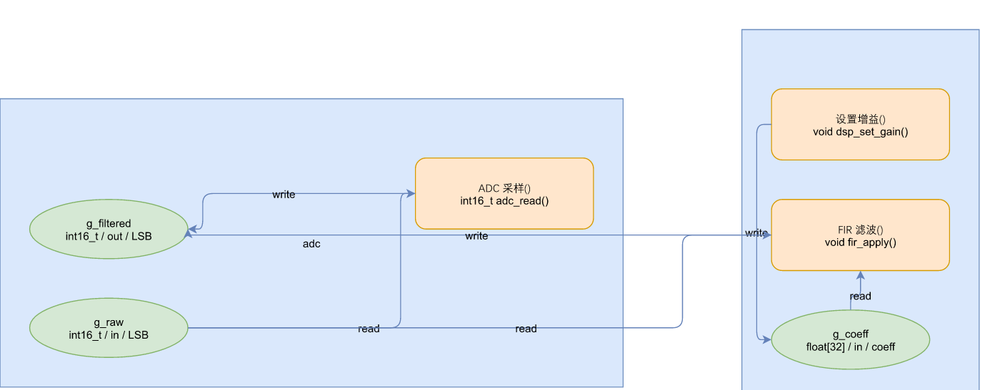

# drawcode

[English](README.md) | **中文** | [Español](README.es.md)

> 把带注解的 C / C# 源码变成一张可编辑的 
> [draw.io](https://www.drawio.com/) 数据流图 —— 
> 并把你手工排好的布局读回代码。三个独立实现：Python、TypeScript、.NET 10。

可在 Windows、Linux 与 macOS 上运行。任何实现都没有第三方运行时依赖：
Python 3.10+、Node 22.6+，或 .NET 10（任选一个）。



## 它解决什么问题

大多数「代码转图」工具生成一张图就到此为止。一旦有人改动代码，图立刻就过期了，
因为**这张图悄悄变成了第二份事实源** —— 而两份事实源总会漂移。通常的补救更糟：导出一份中间 JSON，
再发明哈希、漂移检测与三方合并去调和它们。

`drawcode` 采取的是相反的立场。

- **源码是唯一事实源。** 语义写在代码里，用宏、特性和结构化注释表达。
  任何中间 JSON 都不会落盘 —— IR 只存在于内存中，每次运行都从代码重建。
- **图上只承载代码无法表达的东西**：布局，而布局是人的决定。在 draw.io 里拖动一个节点，
  新位置会在下一次运行时回写进 IR。
- **反向是刻意收窄的。** 只有*声明层*会被回写 —— `SIGNAL_*` 宏语句与注解属性。
  **函数体逻辑永不改写**，这是设计使然。
- **幂等。** 构建 → 编辑 → sync → 构建，产生零代码变更。这一点由测试断言，而不是假定。
- **三个实现，一份规格。** Python、
  TypeScript 与 .NET 对同一输入产生可比对到字节的几何，
  并由共享金标准校验 —— 所以 
  [`docs/benchmark.md`](docs/benchmark.md) 里的性能比较是同类比同类。

## 快速开始

```bash
git clone <this-repo> && cd drawcode

# Python - no install, run straight from the source tree
export PYTHONPATH=python/src           # Windows: $env:PYTHONPATH = "python/src"
python -m drawcode.cli build \
    examples/small/c/adc.h examples/small/c/adc.c \
    examples/small/c/dsp.h examples/small/c/dsp.c \
    --root examples/small/c \
    --out out/flow.drawio --svg out/flow.svg

# TypeScript - no install, Node >= 22.6 runs the .ts entry point directly
node typescript/bin/drawcode.ts build \
    examples/small/c/adc.h examples/small/c/adc.c \
    examples/small/c/dsp.h examples/small/c/dsp.c \
    --root examples/small/c --out out/flow-ts.drawio

# .NET 10 - build once, then run the produced dll
dotnet build dotnet/DrawCode.slnx -c Release
dotnet dotnet/src/DrawCode/bin/Release/net10.0/DrawCode.dll build \
    examples/small/c/adc.h examples/small/c/adc.c \
    examples/small/c/dsp.h examples/small/c/dsp.c \
    --root examples/small/c --out out/flow-net.drawio

# Open a .drawio in draw.io, rearrange the nodes, save, then reuse that layout
# and write the annotations back into your source:
python -m drawcode.cli build ... --layout-from out/flow.drawio --out out/flow.drawio
python -m drawcode.cli sync out/flow.drawio examples/small/c/*.h examples/small/c/*.c \
    --root examples/small/c                    # dry run: reports what would change
python -m drawcode.cli sync out/flow.drawio examples/small/c/*.h examples/small/c/*.c \
    --root examples/small/c --write            # actually write
```

三种实现对同一份输入产出的 `.drawio` **逐字节相同**。
等价性对照表与各语言的测试命令见
[`docs/implementations.md`](docs/implementations.md)。

## 命令行用法

```
drawcode build <files...> [--root DIR] [--out FILE] [--merge] [--layout-from FILE] [--svg FILE]
                [--inline] [--cards] [--no-rw-labels] [--straight-edges]
drawcode sync  <drawio> <files...> [--root DIR] [--write]
drawcode inspect <artifact> [--out FILE] [--infer-edges]
```

| 命令 | 作用 |
| :--- | :--- |
| `build` | 解析源码 → 构建 IR → 写出 `.drawio`。`--layout-from` 复用既有图的人工布局。`--svg` 额外产出一份只读预览，与 `.drawio` 共享同一套坐标。 |
| `sync` | 读取 `.drawio` → 应用布局与注解属性 → 把**声明层**回写到源码。不加 `--write` 时是空跑。 |
| `inspect` | 只读解析编译产物（`.dll` / `.so` / `.out` / `.a` / `.o`），输出规范 JSON。不加载、不执行目标程序；仅 TypeScript 实现提供，不参与三实现一致性比对。 |

`--inline` 把「一写一读」的信号折叠成设备直连边，`--cards` 把带 `asset` 的函数画成图片卡片，
`--no-rw-labels` 去掉边上的 `read`/`write`，`--straight-edges` 用直线替代正交布线。三份实现
接受同名同义的开关；不带开关时产物与旧行为逐字节相同。

## 核心概念

1. **一份持久事实源，一个派生产物。** 代码是事实；`.drawio` 是视图，外加只有人能提供的布局。
   细节：[`docs/architecture.md`](docs/architecture.md)。
2. **注解是解析器唯一推断不出来的东西。** 方向与元数据是*写进代码*的：
   C 侧写成 `/// @drawcode` 注释、C# 侧写成 `[Drawcode(Direction.In)]` 特性。
   字段级参考：
   [`docs/annotations.md`](docs/annotations.md)。
3. **边是派生的，不是解析出来的。** `read`/`write` 边来自扫描函数*体*里碰了哪些全局量。
   改一条注释只会改一个标签；它永远不会移动一条线。这常常令人意外，而且这是刻意的。
4. **坐标是相对父容器的。** 在 `.drawio` 里，
   `mxGeometry` 与 `mxPoint` 都相对于其容器。
   `read_layout` 换算成画布绝对坐标，
   `to_drawio` 换算回去 —— 这个唯一换算点防止漂移在多次往返中累积。
5. **draw.io 默认压缩。** 保存时它把 `<diagram>` 内容存成 
   `base64(raw-deflate(url-quote(xml)))`。
   只读纯 XML 意味着**静默返回空布局**，并丢弃用户手工排好的版。这里两种形态都读，
   读不出来的载荷会抛错而不是返回空。格式细节：
   [`docs/drawio-format.md`](docs/drawio-format.md)。

## 文档

| 想了解 | 读 |
| :--- | :--- |
| 为什么设计是这个形状 | [`docs/architecture.md`](docs/architecture.md) |
| 每一个注解键，含类型与默认值 | [`docs/annotations.md`](docs/annotations.md) |
| `.drawio` 映射、路由规则、坐标系语义 | [`docs/drawio-format.md`](docs/drawio-format.md) |
| 实测性能，三个实现 | [`docs/benchmark.md`](docs/benchmark.md) |
| 三个实现怎么被约束到同一份规格 | [`docs/conformance.md`](docs/conformance.md) |
| 构建、测试、加一门语言 | [`docs/contributing.md`](docs/contributing.md) |
| 自己实现这套能力 | [`python/SKILL.md`](python/SKILL.md)、[`typescript/SKILL.md`](typescript/SKILL.md)、[`dotnet/SKILL.md`](dotnet/SKILL.md) |

## 开发

```bash
cd python && python -m unittest discover -s tests -t .    # 145 tests
cd typescript && npm test
cd dotnet && dotnet test

pwsh bench/run.ps1                                        # three-language benchmark
```

实测环境：Windows 11 (10.0.22621)，
Python 3.14.6，Node 24.16.0，
.NET SDK 10.0.203。

## 实测验证

**本仓库没有任何一个数字是估计的。** 下表中每一个数字都是由同一列的命令跑出来的。

| 主张 | 如何测量 | 结果 |
| :--- | :--- | :--- |
| Python 实现是正确的 | `python -m unittest discover -s tests -t .` | **145 个测试，0 失败，0 跳过** |
| 压缩态 `.drawio` 被正确读取 | 读回一个 draw.io 压缩过的金标准文件 | **nodes=6, edges=6, attrs=6** —— 与纯文本形态完全相同 |
| 读不出的载荷不会静默失败 | `read_layout('<mxfile><diagram>not-a-payload</diagram></mxfile>')` | 抛 `ValueError` |
| 生成的 `.drawio` 符合 schema | 用 `lxml` XMLSchema 对着 `tools/xsd/mxfile.xsd` 校验 | **3/3 通过**（C、C#，以及一张带拐点的图） |
| 往返幂等 | 构建 → sync → 构建，比较 | **第二次 sync 零改动** |
| 布局开销 | `bench/run.ps1`，5/10/20/40/80 个模块 | 0.36 s / 1.45 s / 5.89 s / 23.3 s / 95.4 s —— **超线性，见下** |
| 解析开销，同批运行 | 同上 | 4.0 / 6.6 / 12.9 / 26.8 / 52.9 ms —— 线性 |
| 三个实现一致 | `tests/golden/*/expected.{ir.json,drawio}` | 见 [`docs/benchmark.md`](docs/benchmark.md) |

布局那些数字才是有意思的结果：
**解析是线性扩展的，而布局是二次的。** 路由每条边都要拿候选路径去试所有其它节点，
所以一个 80 模块的工程会在布局上花 95 秒，而解析只花 53 毫秒。这一点是作为特征写出来的，
而不是当作舍入误差藏起来 —— 基准文档记录了时间究竟花在哪。

## 已知限制（诚实列出）

- **布局是 O(n²)**，所以大工程慢。目前没有使用任何空间索引。这一点对三个实现同等适用。
- **离线渲染器画不出 `jumpStyle=arc` 跳线。** `jumpStyle` 是 
  draw.io 的扩展，开源 mxGraph 核心没有。生成的文件把它配置正确，
  draw.io 客户端也会照做，但 `tools/render/` 不会显示跳线。
  请在 draw.io 里验证跳线。
- **swimlane 容器标题在离线渲染器里渲染在中央**，而在 draw.io 里出现在左上角。
  这是渲染器的限制，不是生成器的 bug。
- **离线渲染器的中日韩文字测量是估算的。** jsdom 没有排版引擎，
  报告的 `offsetWidth = 0`，所以字宽是近似值。文字本身渲染正确（SVG 定位不依赖该测量）；
  标签的*避让*可能不准。
- **SVG 预览不共享 `.drawio` 的边路由。** 节点位置是共享的（两者都调用同一套默认布局），
  但 `svg.py` 是中心连中心画边，而 `to_drawio` 会跑完整的锚点选择与避障。
  因此 SVG 的边会穿过 `.drawio` 绕开的节点形状。把 SVG 当作结构性速读，而不是忠实预览。
  修好它需要把 `to_drawio` 重构出共享的边几何函数。
- **函数体永不回写。** 这是设计约束，不是缺口。
- **混合语言的单张图不做符号解析。** C 与 C# 的模型可以合并，但跨语言引用同名符号不会被解析。
- **多页 / 多视图、图层与标签过滤没有接到 CLI。**
- **跨实现的几何相等要求移植同一套算法。** 这正是重点 —— 但也意味着所谓「换一种优化方式」的实现，
  只允许改*算得多快*，永远不能改*算出什么*。

## 许可

[MIT](LICENSE)。
随仓库附带的第三方材料列在 
[`tools/xsd/README.md`](tools/xsd/README.md)。
